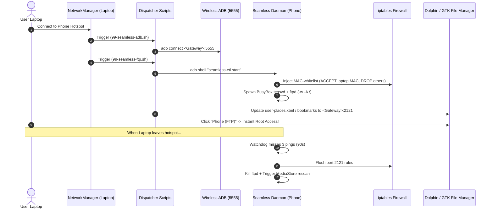

# 🐧🤖 Seamless Connect

> **Build your own "Apple Ecosystem" Continuity with Linux, Android, and Open Standards.**  
> Handsfree Wireless ADB + Instant Root FTP File Sharing with Hardware MAC-Locked Security & Dolphin Places Auto-Mount.

[](LICENSE)
[](#android-phone-setup)
[](#linux-laptop-setup)

---

## 🌟 The Vision

Apple charges an arm and a leg for "Continuity" and "AirDrop." Seamless Connect brings that exact seamless, zero-click experience to **Linux** and **rooted Android**:

1. **Zero-Click Wireless ADB (TCP/IP)**: The moment your laptop connects to your phone's Wi-Fi hotspot, ADB connects automatically over port 5555. No cables. No prompts.
2. **Instant Handsfree File Sharing (Root FTP)**: Your phone's entire filesystem mounts in your Linux file manager (KDE Dolphin, Nemo, Nautilus) under a pinned **"Phone (FTP)"** bookmark.
3. **Hardware MAC-Locked Security**: BusyBox `ftpd` has no login prompt (`-A` flag for instant passwordless root access). Security is strictly enforced at the Linux kernel level via `iptables`: **only incoming packets from your authorized laptop's Wi-Fi MAC address are accepted; all other devices on the hotspot are dropped immediately.**
4. **Dynamic IP Adaptation (Dolphin & GTK Places Sync)**: Phone hotspots assign random subnets on every boot (e.g. `10.x.x.1`, `192.168.43.1`). The Linux client dynamically updates Dolphin's `user-places.xbel` and GTK's bookmarks in real-time. You never have to re-enter an IP address.
5. **Self-Cleaning Watchdog**: An intelligent phone-side background watchdog pings your laptop every 30 seconds. If you leave the hotspot, it shuts down the FTP daemon, cleans up all firewall rules, and triggers an Android MediaStore rescan.
6. **Android Companion App**: Manage authorized laptops, view live service status, scan connected hotspot clients, and authorize new laptops with a single tap.

---

## 🏗️ Architecture



---

## 📱 Android Phone Setup

### Prerequisites
- Rooted Android device running **Magisk 25+**, **KernelSU**, or **APatch**.
- BusyBox installed (included by default in Magisk / KernelSU).
- Wi-Fi Hotspot enabled.

### Installation Options

#### Option A: Flash the Magisk / KernelSU Module (Recommended)
1. Download `seamless_connect_magisk.zip` from [Releases](https://github.com/seamlessconnect/releases) or build it using `./build.sh`.
2. Flash the zip in **Magisk**, **KernelSU**, or **APatch** app.
3. Reboot your phone. The `Seamless Connect` app and `seamless-ctl` command-line utility will be installed automatically.

#### Option B: Standalone APK & CLI
1. Install `SeamlessConnect.apk` using ADB or your favorite file manager:
   ```bash
   adb install SeamlessConnect.apk
   ```
2. Grant Root permissions to Seamless Connect when prompted.

---

## 💻 Linux Laptop Setup

### Prerequisites
- Linux distribution running **NetworkManager** (Ubuntu, Kubuntu, Fedora, Arch, Linux Mint, Debian, etc.).
- File manager: **KDE Dolphin** (KDE Plasma) or **GTK-based** (Nautilus, Nemo, Thunar, PCManFM).
- Android platform-tools (`adb`).

### 1-Command Installation
Run the installer script on your laptop:

```bash
git clone https://github.com/seamlessconnect/seamless_connect.git
cd seamless_connect/linux
sudo ./install.sh
```

The installer will:
1. Detect your active graphical user account.
2. Install `seamless-update-places` into `/usr/local/bin/`.
3. Install NetworkManager dispatcher scripts (`99-seamless-adb.sh` and `99-zz-seamless-ftp.sh`) into `/etc/NetworkManager/dispatcher.d/`.
4. Create the initial **Phone (FTP)** pinned place in Dolphin and GTK file managers.
5. Print your laptop's **Wi-Fi MAC address**.

---

## 🔐 Authorizing Your Laptop

Seamless Connect will refuse any FTP connections until your laptop's Wi-Fi hardware MAC address is added to the phone's whitelist.

### Method 1: Using the Android Companion App (Easiest)
1. Turn on your phone's Hotspot and connect your laptop to it.
2. Open the **Seamless Connect** app on your phone.
3. Under **Connected Hotspot Devices**, you will see your laptop listed with its IP and MAC.
4. Tap **`+ Authorize`**, give your laptop a nickname (e.g. `ThinkPad Z13`), and tap **Authorize**.
5. The firewall is updated live in kernel space!

### Method 2: Via Root Terminal / ADB (`seamless-ctl`)
```bash
# On phone (in Termux with su) or via ADB shell:
su -c "seamless-ctl add-mac <YOUR_LAPTOP_MAC> 'Work Laptop'"
```

To list authorized MAC addresses:
```bash
su -c "seamless-ctl list-macs"
```

---

## 📂 Pinned Location in Dolphin & GTK File Managers

When you join your phone's hotspot:
- In **KDE Dolphin**: A pinned item named **"Phone (FTP)"** appears under the *Places* panel. Clicking it opens `ftp://phone:phone@<HOTSPOT_IP>:2121/` with full root read/write access.
- In **Nemo / Nautilus / Thunar**: A bookmark named **"Phone (FTP)"** in the left sidebar connects to the phone.
- **No IP headaches**: When your phone's hotspot IP changes (e.g. from `10.236.58.173` to `192.168.43.1`), the dispatcher script automatically detects the new gateway and updates the bookmark XML without requiring any user action.

---

## 🛠️ CLI Management (`seamless-ctl`)

On the phone, you can run `seamless-ctl` from any root shell:

```bash
seamless-ctl status            # Show live service status, ports, and connected clients
seamless-ctl start             # Start the FTP daemon manually
seamless-ctl stop              # Stop the FTP daemon manually
seamless-ctl restart           # Reload configuration and restart firewall
seamless-ctl clients           # Scan ARP table for connected hotspot devices
seamless-ctl list-macs         # List all authorized MAC addresses
seamless-ctl add-mac <mac>     # Authorize a new MAC address
seamless-ctl del-mac <mac>     # Revoke a MAC address
seamless-ctl rescan-media      # Force Android MediaStore library update
```

---

## ⚙️ Configuration (`seamless.conf`)

Stored on the phone at `/data/adb/seamless_connect/seamless.conf`:

```bash
# FTP Server Port
PORT=2121

# Hotspot interface: "auto" detects wlan0, wlan1, wlan2, ap0 dynamically
IFACE="auto"

# Watchdog check interval (seconds)
WATCH_INTERVAL=30

# Misses before auto-teardown when laptop leaves
WATCH_MISSES=3

# Root directory for media scanner upload detection
SCAN_ROOT="/sdcard/"

# Ensure ADB TCP/IP listening on boot (port 5555)
ENABLE_ADB_PERSIST=1
```

---

## 🏗️ Building from Source

The repository includes a self-contained build script that compiles both the Android APK and the Magisk module using command-line SDK tools:

```bash
# Ensure ANDROID_HOME or ANDROID_SDK_ROOT is set
./build.sh
```

Output files will be generated in `build/release/`:
- `build/release/SeamlessConnect.apk`
- `build/release/seamless_connect_magisk.zip`

---

## 💡 Troubleshooting & FAQs

#### Q: Dolphin shows "Connection Refused" or hangs.
1. Check that your laptop's Wi-Fi MAC address is authorized in the app or via `seamless-ctl list-macs`.
2. Verify FTP server is running: `adb shell "su -c 'seamless-ctl status'"`.
3. Verify firewall rules: `adb shell "su -c 'iptables -S INPUT | grep 2121'"`.

#### Q: New photos or music transferred via FTP don't appear in Android gallery/music apps.
FTP writes directly to the Linux filesystem as root, bypassing the Android `MediaProvider`. Seamless Connect includes an automated upload detector that compares file modification times against a baseline marker. As soon as uploads finish, it triggers:
```bash
content call --uri content://media --method scan_volume --arg external_primary
```
You can also manually trigger a scan from the companion app or with `seamless-ctl rescan-media`.

#### Q: What about Windows support?
Windows support is planned for future releases using Windows PowerShell / Task Scheduler scripts listening for Wi-Fi SSID change events to update Windows Explorer network locations.

---

## 📜 License
Licensed under the [MIT License](LICENSE). Contributions, bug reports, and pull requests are welcome!
